# ResTeaM

**Une vitrine pour Steam sur Windows** : bibliothèque, magasin, amis, profil et téléchargements dans une interface sombre, vivante et soignée. ResTeaM s'appuie sur le compte et le client Steam ; il ne les remplace pas.

Projet personnel de [Y1UNO](https://github.com/Y1UNO), construit étape par étape avec Claude Code (Anthropic). Chaque étape se termine par un exe testé au quotidien.

> Les captures ci-dessous viennent du mode aperçu, avec des données factices.

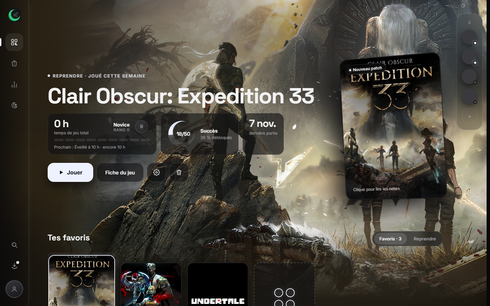

## Ce que fait l'app

| Page | Contenu |
|---|---|
| **Accueil** | Le dernier jeu joué en grand (affiche floutée, rang, succès), un bouton Jouer, une jaquette 3D qui se déplie en patch notes, un ruban des favoris et le panneau des amis |
| **Bibliothèque** | Tous les jeux, avec filtres (installés, favoris, récents), tri, recherche et clic droit (Jouer, Propriétés, Ouvrir le dossier, Désinstaller…) |
| **Magasin** | Recherche, promos à la une, rayons par genre, jeux gratuits, prix qui défilent. L'achat se fait toujours dans Steam |
| **Fiche d'un jeu** | Description, avis, captures, DLC, configuration, et les **propriétés du jeu** (options de lancement, mises à jour, téléchargements pendant le jeu) |
| **Classements** | Meilleures ventes et jeux les plus joués, avec les joueurs en direct |
| **Liste de souhaits** | Les promos en premier, l'affiche au survol |
| **Téléchargements** | Débit et disque en direct, file d'attente, glisser un jeu pour l'installer |
| **Amis et profils** | En ligne / en jeu, profil des amis, jeux en commun |
| **Communauté** | Fil des amis (qui joue à quoi, jeux du moment), Workshop (mes mods installés et vitrine d'un jeu, avec recherche ; **installer et retirer un mod directement depuis ResTeaM**, avec la progression ; les fonds vidéo installés sont lus en pleine qualité), mes captures d'écran Steam, créations de la communauté (illustrations, captures, vidéos, guides) |
| **Profil** | Rangs de temps de jeu de Novice à Éternel (0 h → 10 000 h), lune du niveau, badges, personnalisation (fond, cadre, ambiance, photo et bannière perso, objets Steam) |

| | |
|---|---|
| 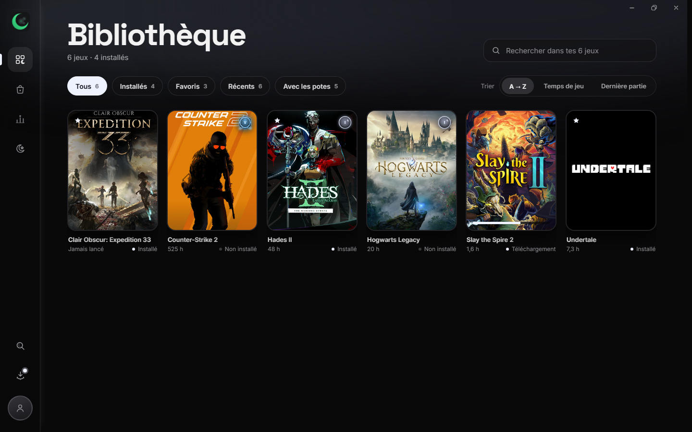 | 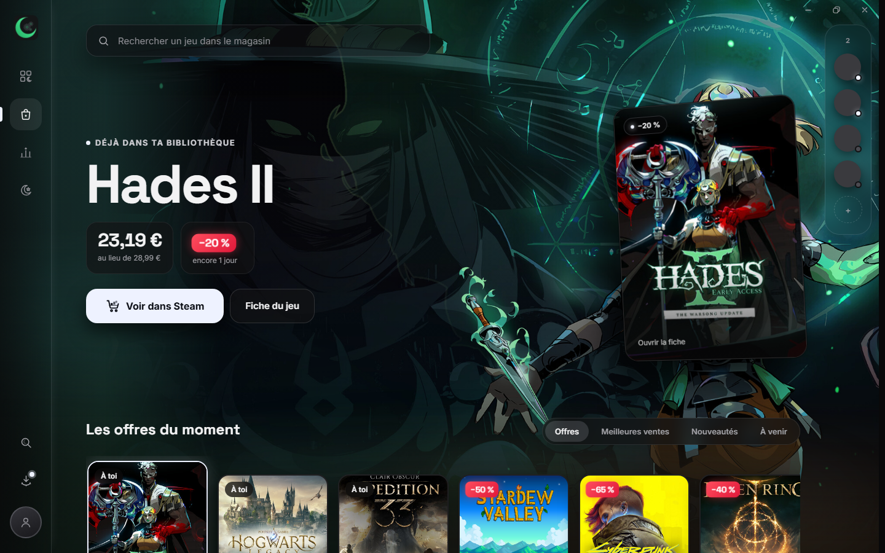 |
| 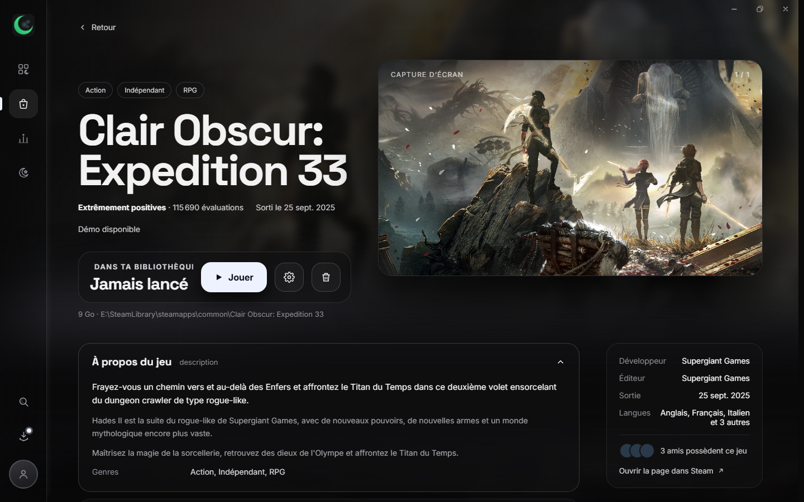 | 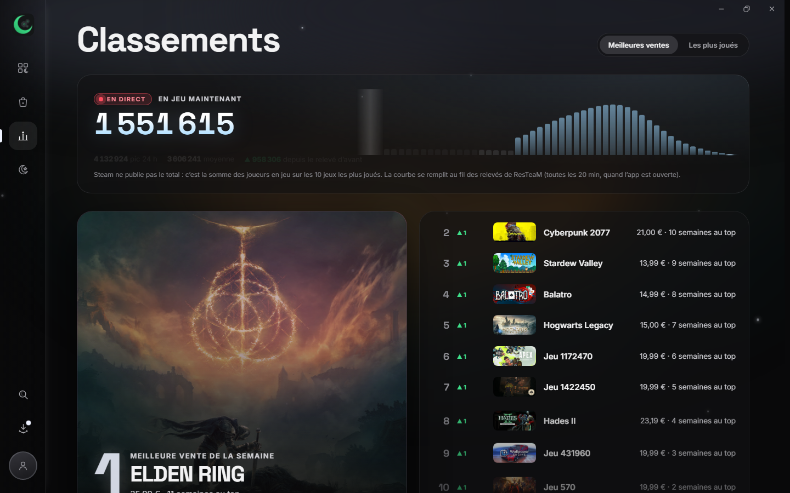 |
| 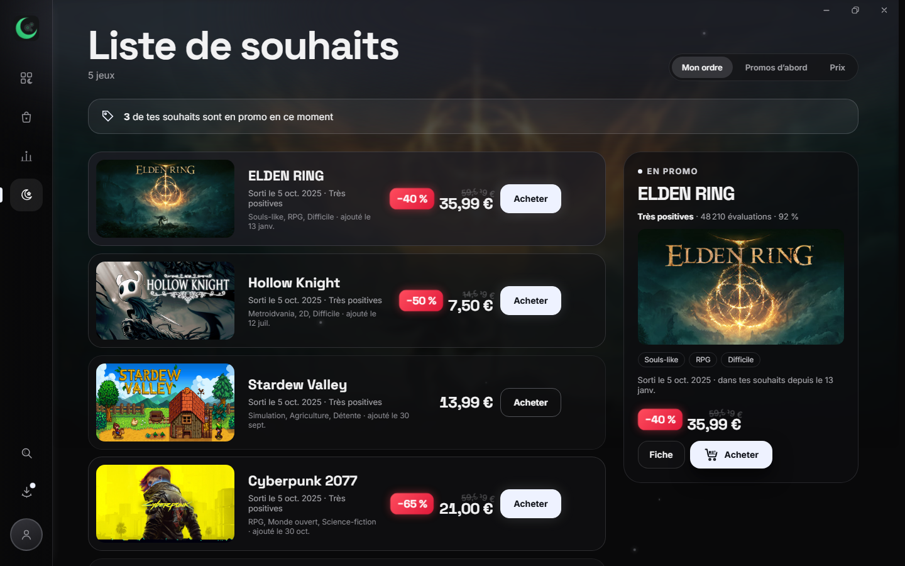 | 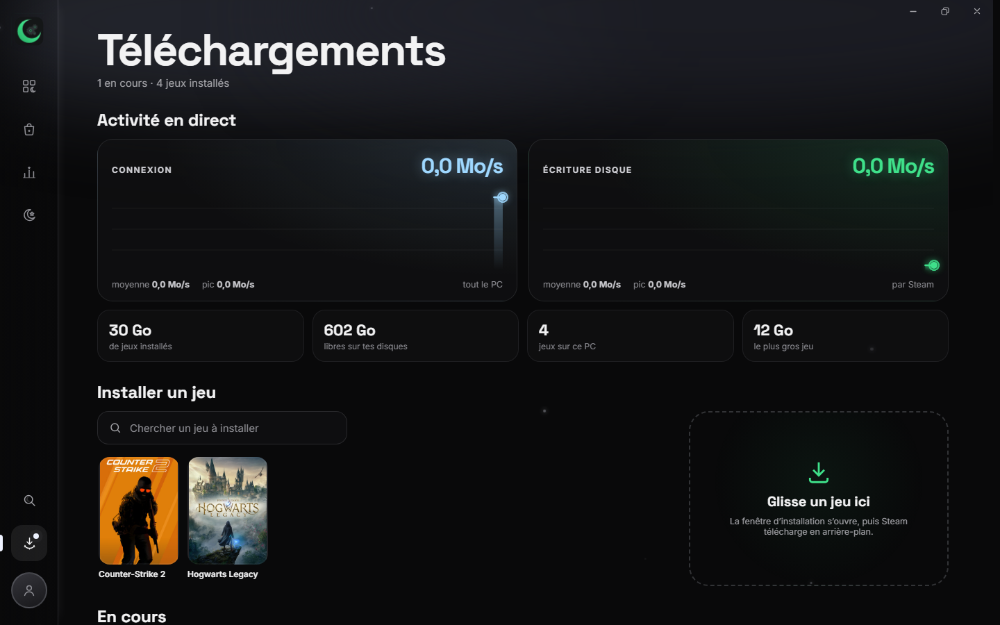 |
| 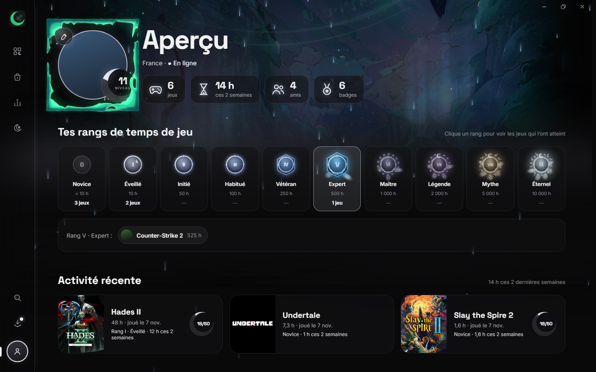 | 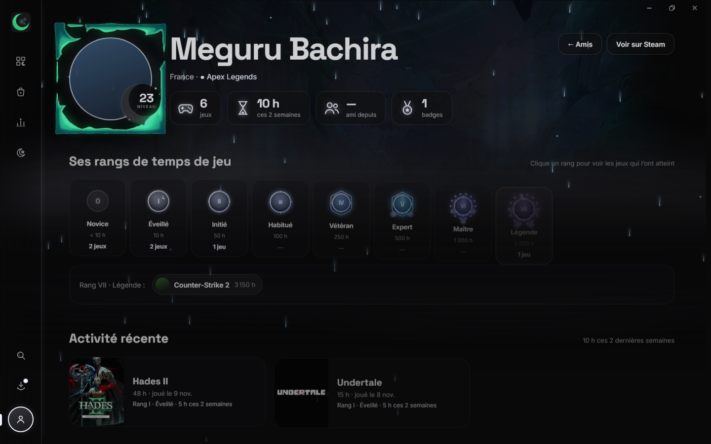 |
| 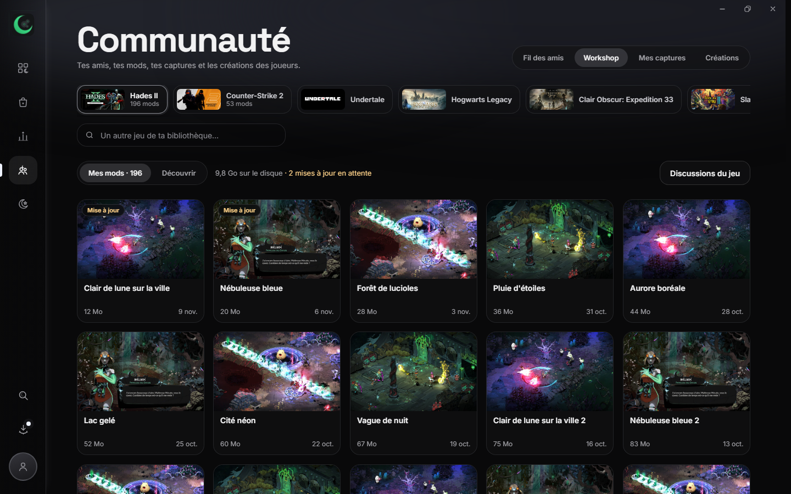 | 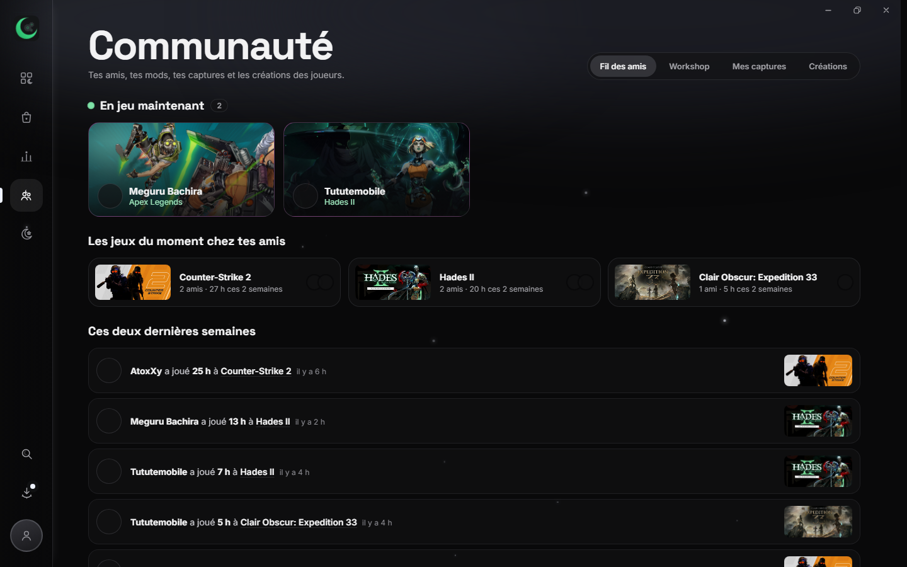 |
| 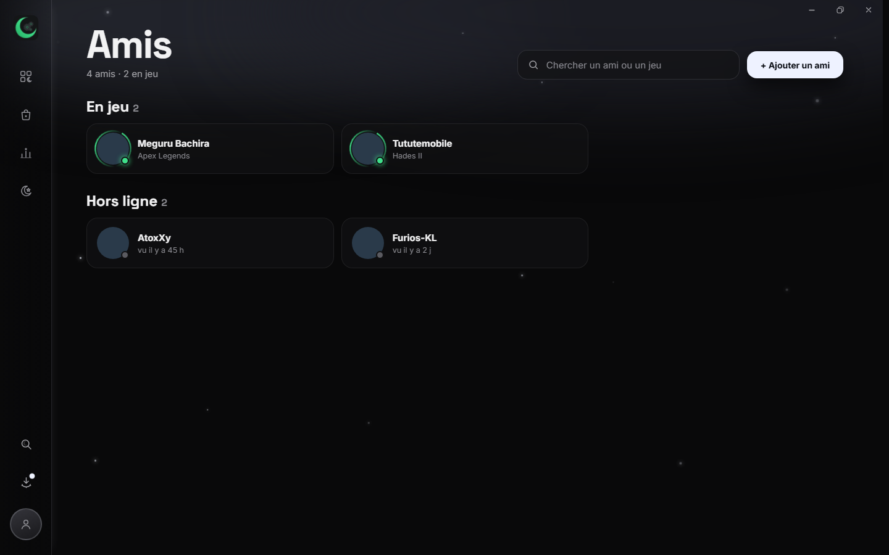 | 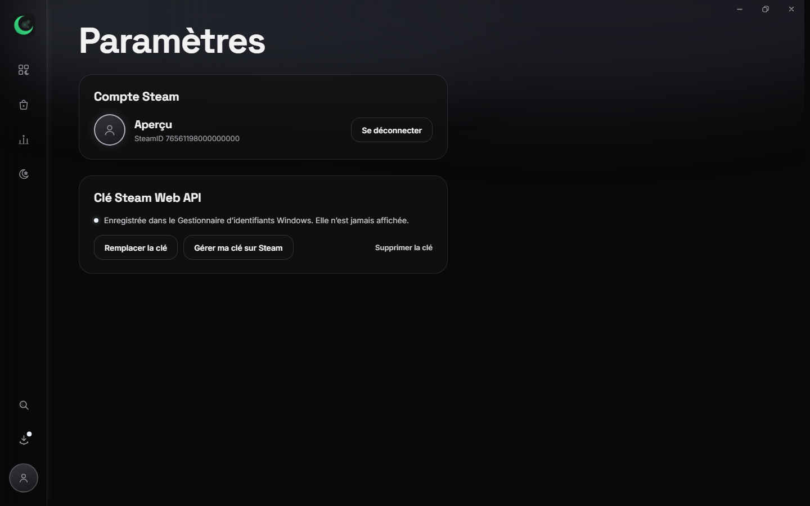 |

## Direction artistique : « Nocturne · Clair de lune »

- Fond presque noir `#09090A`, une seule couleur d'accent (`#EEF2FF`) réservée aux interactions.
- Polices Space Grotesk et Inter, verre fumé, fumée monochrome.
- Éléments signature : affiche floutée en fond, jaquette inclinée en 3D, croissants de lune pour les succès et le niveau, badges de rang animés, pluie lunaire.
- Les animations n'utilisent que `transform` et `opacity`, pour rester fluides.

## Technique

- **Tauri 2** (Rust) + **React 19** + **TypeScript** + Vite, avec TanStack Query et Zustand.
- **Tout le réseau passe par Rust** : Steam Web API, endpoints publics du magasin, cache SQLite (fonctionne hors ligne), cache disque des images via un protocole `img://` maison.
- **Lecture des fichiers de Steam** (manifestes, `localconfig.vdf`, bibliothèques) pour les jeux installés, les favoris et les propriétés. Les écritures se font seulement Steam fermé, avec copie de secours et écriture atomique.
- **Connexion Steam OpenID** : ResTeaM ne voit jamais le mot de passe.
- **Clé Web API** rangée dans le Gestionnaire d'identifiants Windows. Elle ne quitte jamais Rust et n'est jamais écrite dans un fichier.
- Installation et désinstallation pilotées par Steam (`steam://`), avec une file d'attente si un jeu tourne.
- **Workshop** : Steam n'ayant pas d'API web pour s'abonner, une petite aide séparée (`resteam-workshop.exe`, API Steamworks) s'abonne ou se désabonne au nom du jeu, puis Steam télécharge en arrière-plan.

```
src/          interface React (pages, composants, appels typés vers Rust)
src-tauri/    cœur Rust (Steam Web API, fichiers de Steam, cache, protocole d'images)
kit/          kit de design (maquettes, captures, références)
docs/         captures des pages
PLAN.md       plan et journal détaillé de chaque étape
AUDIT-SECURITE.md  audit de sécurité
```

## État et suite

Fait : accueil, bibliothèque, magasin, fiche et propriétés des jeux, classements, liste de souhaits, téléchargements, amis, profil personnalisable, recherche globale, mode hors ligne, audit de sécurité, Communauté (Workshop, captures, créations, fil des amis).

À venir (détails dans [PLAN.md](PLAN.md)) :
- total des trophées et lune du profil à 30 niveaux ;
- paramètres de Steam ;
- remplacer Steam au quotidien (démarrage avec Windows, zone de notification) ;
- notifications Windows ;
- manette et plein écran ;
- serveur gratuit pour partager son profil ResTeaM avec ses amis.

## Lancer le projet

Prérequis : Windows, Steam installé, Node.js et Rust.

```bash
npm install
npm run tauri dev
```

Aperçu dans un navigateur, avec des données factices :

```bash
npm run build
npm run preview
```

Puis ouvrir `http://localhost:4173/?apercu=connecte`.

ResTeaM n'est pas affilié à Valve. Steam est une marque de Valve Corporation.
